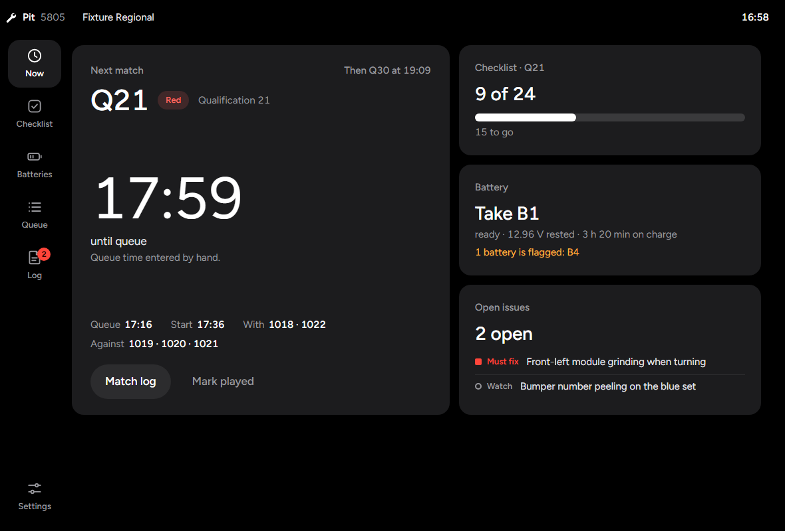

# Catalyst Pit

The match-day pit companion for FRC drive teams. Catalyst installs the library, Catalyst Console
shows the robot while it drives, Catalyst Sim is practice; Pit is the twenty minutes between
matches, when the questions are *is it ready*, *which battery* and *when are we up*.

It runs on the driver station laptop and needs no network.



## What it does

| Screen | What it is for |
|---|---|
| **Now** | Left up between matches: the next match and how long until it queues, how far the checklist is, which battery to take, what is still broken. |
| **Checklist** | The pre-match list, grouped (mechanical, electrical, software, drive team). Ticks belong to a match, so every match starts blank. Stamping records the run with its time, its match and anything skipped. Open issues sit above the list until they are fixed. The list is editable. |
| **Batteries** | Each battery by its label: where it is in the loop (charging, ready, in robot, resting, retired), its resting voltage and internal resistance, its cycle count. It recommends the next one and flags weak ones. |
| **Queue** | The team's matches in playing order, from Nexus for FRC or typed in by hand. |
| **Log** | Per match: battery used with its voltage in and out, the checklist result, notes, issues raised. Exports the event as a Markdown report. |
| **Settings** | Team number, event, Nexus, the robot link, battery limits. |

More screenshots, at the desktop size and the narrow column it takes beside a Driver Station, are
in [`docs/screenshots/`](docs/screenshots). They are taken from invented fixture data; the app
itself ships empty.

## The rules it keeps

1. **It works with no network.** Everything is a local file.
2. **It shows only what is known.** A time is one somebody typed or Nexus sent. A voltage is one
   somebody measured or the robot published. Anything else is a dash or an empty state. A queue time
   is never derived from a start time: with no queue time, the countdown is to the start and says so.
3. **It never writes to the robot.** It opens no Driver Station connection. The one thing it reads
   is the battery voltage, over NetworkTables, through a client with no publish path.
4. **It does not lose notes.** Saves are atomic, with the previous save kept as a backup.

## How the battery recommendation works

Candidates are batteries that are **ready** or **charging**. They are ranked by, in order:

1. not flagged weak
2. marked ready, ahead of still charging
3. a measured resting voltage, highest first (readings within 0.05 V count as equal)
4. longest on charge
5. fewest cycles

A battery is flagged when its internal resistance is at or above 20 mΩ, when it is marked ready but
rests below 12.5 V, or (as a "check", not a disqualification) when it came out of the robot below
11.7 V. The first two limits are this app's defaults, not a standard, and can be changed in
Settings. A resting voltage from before a battery's last match is never reused.

## The schedule

**By hand.** A label (`Q12`, `Practice 3`, `Playoff 5`, `Final 1`) is enough; a start time, a queue
time, the alliance and the other teams are optional. A match is "next" until someone marks it
played: a start time passing proves nothing, because events run late.

**Nexus for FRC.** Enter the event key and an API key in Settings and Pit asks
`https://frc.nexus/api/v1/event/{eventKey}` once a minute, keeping the team's matches and Nexus's
running estimates of their queue and start times. A hand-entered `Q12` and Nexus's
`Qualification 12` are the same match, so Nexus takes over a typed schedule without doubling it, and
whatever was logged against a match stays.

The API key is stored in `settings.json` in the app's data folder, apart from the event data. It is
never sent to the page, never written to the event file, and only ever sent to frc.nexus.

> **Not yet tested against the live API.** No Nexus key was available when this was built. The
> request and the parser are tested against a fixture written from Nexus's public API reference
> (`src/fixtures/nexus-event.json`) and a local HTTP server, and every field is read defensively,
> but the field names have not been confirmed with a real response.

## The robot's battery voltage

With "Look for the robot" on, Pit connects to NetworkTables and shows the robot's battery voltage in
the status bar and on the battery screen. WPILib does not publish battery voltage by itself; it
appears when robot code publishes one of `/Catalyst/Status/BatteryVolts`,
`/Catalyst/Brownout/MeasuredVoltage` or `/Catalyst/Systemcore/BatteryVolts`, the same three Catalyst
Console reads. It is shown for reference and is never logged for you.

> The client is Catalyst Console's with the write path removed. Its decoding is unit-tested here,
> but this build has not been run against a robot.

## Data

Plain JSON in the app's data folder (`%APPDATA%\com.frccatalyst.pit` on Windows):

| File | What |
|---|---|
| `pit.json` | The current event (schema 1). |
| `pit.json.bak` | The save before the last one. |
| `settings.json` | Team, Nexus event key and API key, robot link, battery limits. |
| `archive/` | Finished events, one file each, written by "Start a new event". |

A file that will not parse is renamed `pit.json.damaged-<time>` and the backup is opened. A file
from a newer version of the app is refused and left untouched.

## Install and updates

`npm run build` produces `src-tauri/target/release/bundle/nsis/Catalyst Pit_0.1.0_x64-setup.exe`, a
per-user installer.

**There is no auto-update yet.** The sibling apps use Tauri's updater with a signing key; no key
exists for this app, and an updater without one cannot verify what it installs, so the plugin is
left out. To update, install a newer version over this one. The data folder is kept.

## Development

```
npm install
npm run vendor        # copies the Figtree font into src/vendor (nothing is fetched at run time)
npm test              # identity check, node --test, cargo test
npm run harness       # the real UI over a stand-in backend: http://localhost:5210/?fixture=manual
npm run screenshots   # every screen, two sizes, into docs/screenshots
npm run dev           # the app
npm run build         # the installer
```

Needs Node 22 or later and a Rust toolchain. `scripts/cargo.mjs` finds cargo in `~/.cargo/bin` when
it is not on the PATH.

### Layout of the source

| Path | What |
|---|---|
| `src/core/` | The logic, as pure modules with tests: `checklist`, `batteries`, `queue`, `matchlog`, `report`, `store` (the data shape and its migrations), `format`. |
| `src/ui/` | `views/` (one file per screen), `sheet.js` (the one floating layer), `dom.js`. |
| `src/app.js` | The shell: state, save, clock, route, the Nexus and robot polls. |
| `src/styles/identity.css`, `src/motion.js` | Verbatim copies of FrcCatalyst's house stylesheet and springs. `scripts/check-identity.mjs` fails `npm test` when they drift. |
| `src/styles.css` | Pit's own sheet, re-pointing the house tokens to Catalyst Console's Tesla-style palette. |
| `src-tauri/src/` | `storage.rs` (atomic JSON), `settings.rs`, `nexus.rs`, `nt.rs` (read-only NetworkTables), `main.rs` (the commands). |
| `scripts/` | The harness, its fixtures, the screenshot runner, and `contracts.test.mjs`. |

`AGENTS.md` has the invariants for anyone, human or not, changing the code.
